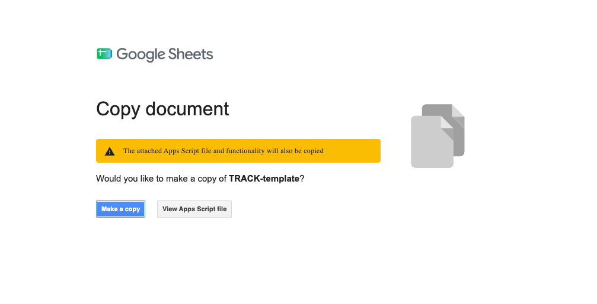
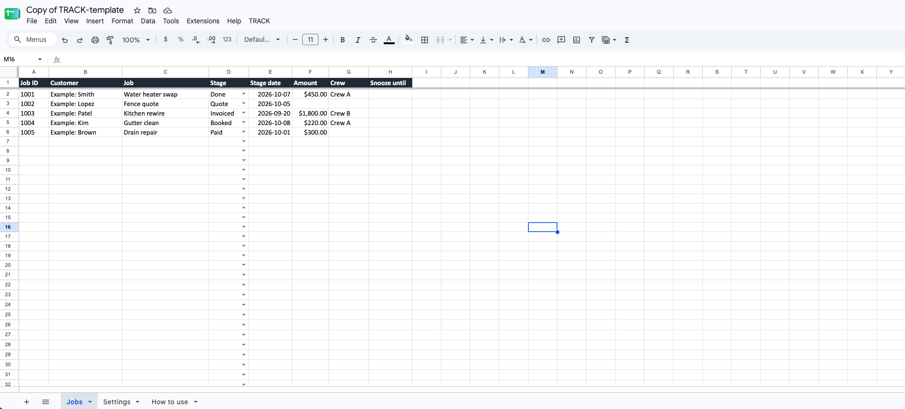
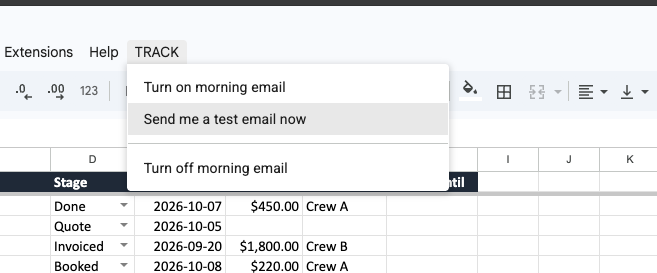
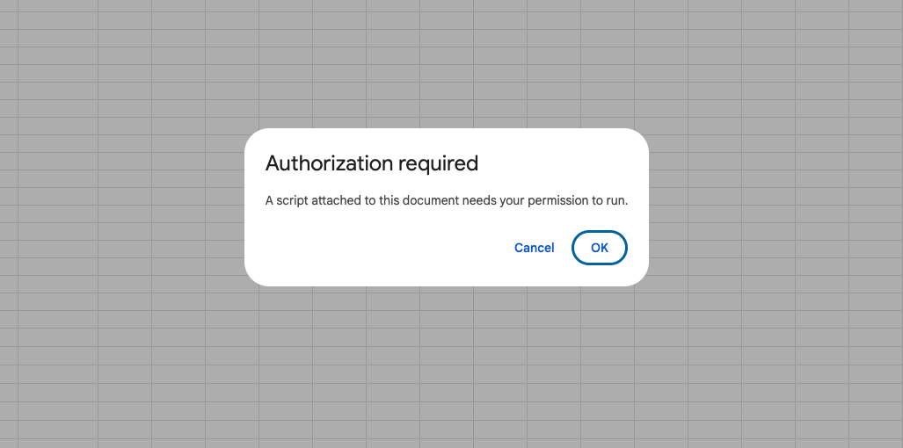
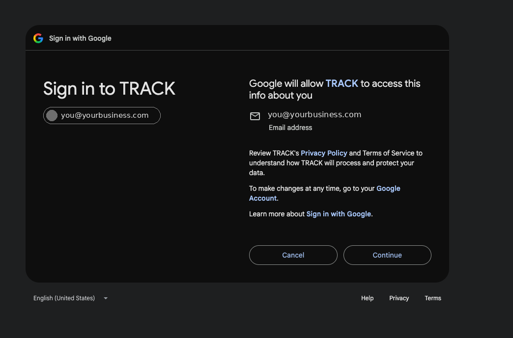
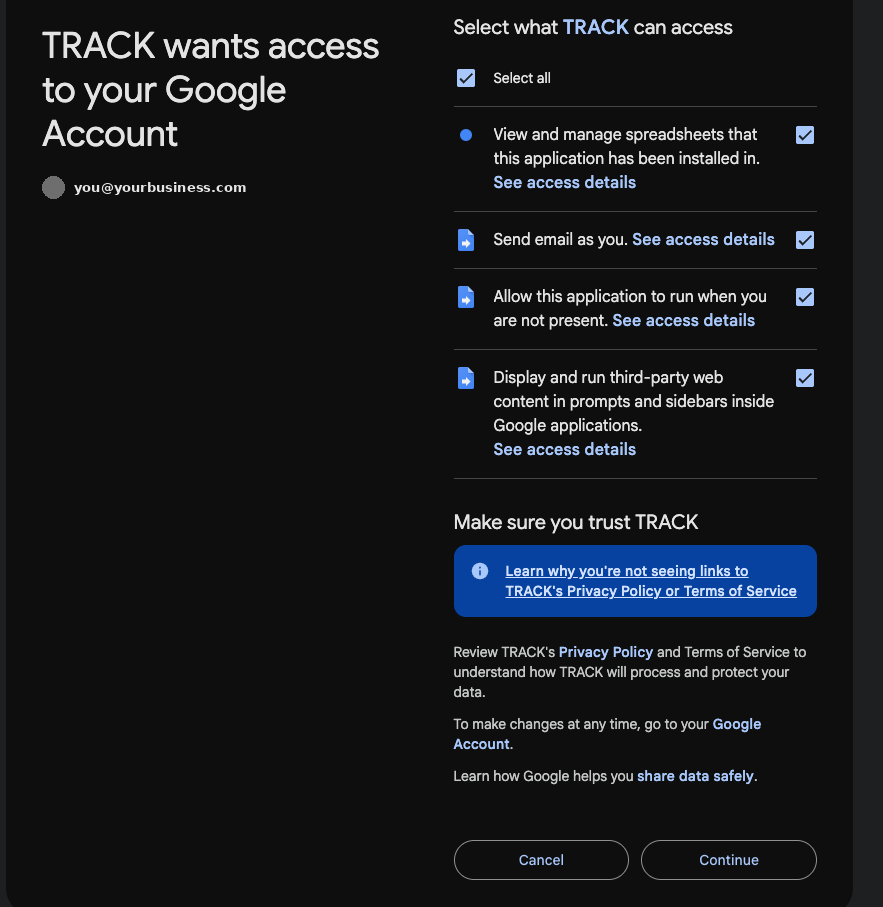
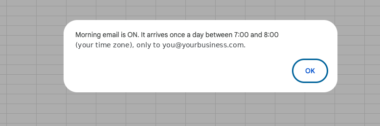
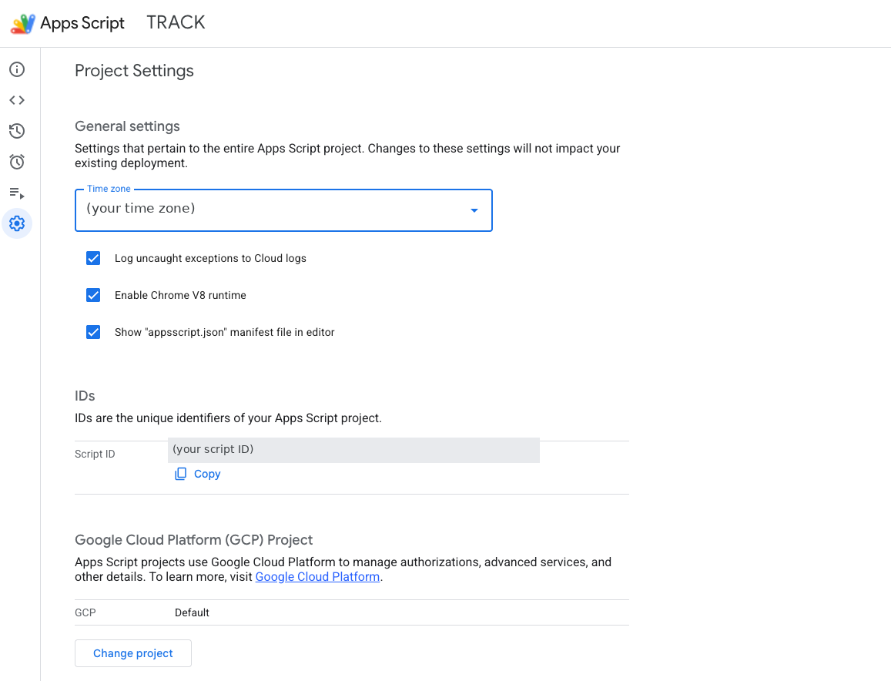
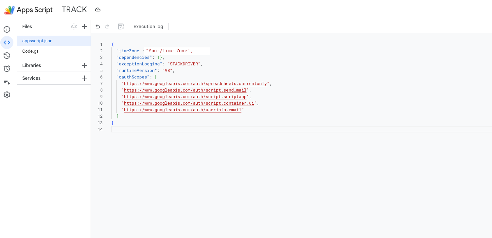

# TRACK setup guide (illustrated)

About 10 minutes. You need a Google account and a computer (Google's script screens don't work well on phones).

There are two ways to set TRACK up:

- **[Option A: make a copy](#option-a-make-a-copy-easiest)** (easiest, about 5 minutes). Start here.
- **[Option B: build it yourself from this repo](#option-b-build-it-yourself-from-this-repo)**, if you want to see and paste in every piece yourself.

*In the pictures below, email addresses, the account picture and time zones have been covered up and replaced with labels like `you@yourbusiness.com`. On your screen you'll see your own.*

---

## Option A: make a copy (easiest)

### 1. Make your copy
Open the **[Make a copy of TRACK](https://docs.google.com/spreadsheets/d/1gWjfnLYyA0tZdqGNxgp2NkI1RvrmCFDjK-4bZ-FtkRY/copy)** link while signed in to your Google account. Google asks if you'd like to make a copy of **TRACK-template** and notes that the attached Apps Script file comes with it. That script is what sends your morning email. Click **Make a copy**.

Your copy, and the script in it, belongs to you. We can't see your copy or your data, and changes we make later won't reach it.

### 2. Find the TRACK menu
Your copy opens as **"Copy of TRACK-template"** (rename it if you like). It has 3 tabs at the bottom: **Jobs**, **Settings** and **How to use**. After a few seconds a **TRACK** menu appears at the top, after **Help**. If it doesn't, reload the page.

Delete the 5 example rows (they start with "Example:") whenever you're ready to add your own jobs.

### 3. Turn on the morning email
Click **TRACK → Turn on morning email**.

The first time, Google asks for your permission. You'll see these screens, in this order:

**a) Authorization required.** "A script attached to this document needs your permission to run." Click **OK**.

**b) Sign in to TRACK.** Pick your Google account. Google says it "will allow TRACK to access this info about you": your **Email address**. TRACK uses it only to send the morning email to you. Click **Continue**.

**c) TRACK wants access to your Google Account.** Under "Select what TRACK can access" Google lists exactly four things:

- View and manage spreadsheets that this application has been installed in.
- Send email as you.
- Allow this application to run when you are not present.
- Display and run third-party web content in prompts and sidebars inside Google applications.

Below that is a **"Make sure you trust TRACK"** panel with a link: "Learn why you're not seeing links to TRACK's Privacy Policy or Terms of Service". That's because TRACK is a script in your own copy, not a published app. Leave all four boxes ticked (or tick **Select all**) and click **Continue**. What each permission is for, in plain words, is in the [README](../README.md#what-the-script-can-and-cant-do-permissions-in-plain-words).

> Sometimes Google also shows a **"Google hasn't verified this app"** warning before this list. It didn't appear in our test, but it can, because TRACK is a personal script rather than an app Google has reviewed. If you see it, click **Advanced → Go to TRACK (unsafe)** to reach the same list.

**d) Done.** A box confirms **"Morning email is ON"**: it arrives once a day within the hour you set on the Settings tab (7:00 to 8:00 by default), in your sheet's time zone, and only to your own address. Click **OK**.

If Google's screens closed without this box, click **TRACK → Turn on morning email** once more.

### 4. Send yourself a test
Click **TRACK → Send me a test email now** and check your inbox (and your spam folder the first time).

### 5. Try it
- Change a job's **Stage**. The **Stage date** fills with today's date.
- Type a date a few days ago into a **Done** job's Stage date, then send a test email. It should list that job.

That's it. To stop the email anytime: **TRACK → Turn off morning email**.

---

## Option B: build it yourself from this repo

### 1. Put the template in Google Sheets
1. Download `template/TRACK-template.xlsx` from this repo (click the file, then the download button).
2. Go to [sheets.google.com](https://sheets.google.com) → **Blank spreadsheet**.
3. **File → Import → Upload**, then choose the file. Pick **Replace spreadsheet** → **Import data**.
4. Check that you have 3 tabs at the bottom: **Jobs**, **Settings**, **How to use**. The tab names must stay exactly like this.
5. **File → Settings → Time zone**: set your local time zone. The morning email and the "days waiting" count use the sheet's time zone.
6. Check the **Stage** column has a dropdown. If it doesn't: select column D from row 2 down, then **Data → Data validation → Add rule → Dropdown**, and add Quote, Booked, Done, Invoiced, Paid, Lost.

*(No Excel file? You can import `template/track-jobs.csv` into a tab named **Jobs** and `template/track-settings.csv` into a tab named **Settings** instead.)*

### 2. Add the script
1. In the sheet: **Extensions → Apps Script**. A new tab opens.
2. Delete whatever is in `Code.gs`, paste in the whole of this repo's [`Code.gs`](../Code.gs), and press Ctrl+S (Cmd+S on a Mac).
3. Click the ⚙️ gear icon (**Project Settings**, bottom of the thin bar on the left) and tick **Show "appsscript.json" manifest file in editor**.

   

4. Click the `< >` icon (**Editor**) in the same left bar. `appsscript.json` now shows under Files. Open it, replace everything with this repo's [`appsscript.json`](../appsscript.json), and save. This keeps the script's permissions as small as possible, so Google asks only for the four permissions shown in Option A.

   

   *The `timeZone` line is only a fallback. TRACK uses the time zone you set in step 1.5, so you don't need to change it.*

5. Rename the project (top left, "Untitled project") to **TRACK**.

### 3. Turn it on
Go back to your sheet tab and reload it. When the **TRACK** menu appears, follow **[Option A, steps 3 to 5](#3-turn-on-the-morning-email)**: the screens are the same.

---

## Troubleshooting
- **No TRACK menu:** reload the sheet and wait a few seconds. Then check **Extensions → Apps Script**: `Code.gs` should hold the TRACK code, not an empty `function myFunction() {}`. If it's empty, paste in [`Code.gs`](../Code.gs) and save (Option B, step 2).
- **Google asks for "all your Google Sheets spreadsheets":** the `appsscript.json` manifest is missing or wasn't saved. Do Option B, steps 2.3 and 2.4, then turn the email on again.
- **"No tab called Jobs":** rename your jobs tab to exactly `Jobs`.
- **Stage date didn't fill:** it only fills when you edit the **Stage** column directly. Pasted or imported rows need the date typed in.
- **Email arrives at the wrong hour:** check **File → Settings → Time zone**, then click **TRACK → Turn on morning email** again.
- **Stop everything:** click **TRACK → Turn off morning email**, and/or remove access at [myaccount.google.com/permissions](https://myaccount.google.com/permissions).
